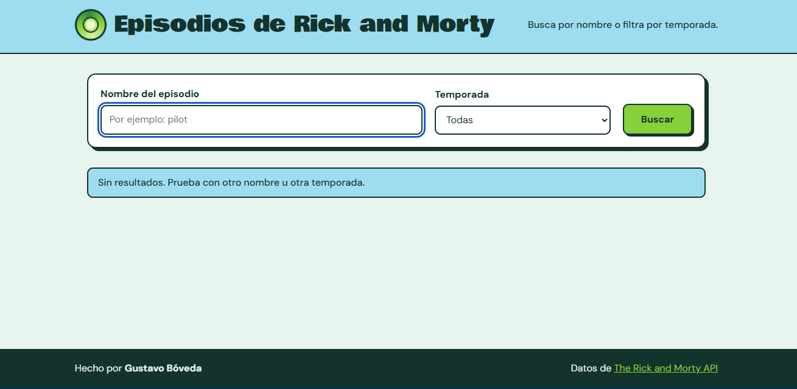

# Episodios de Rick and Morty

**Autor:** Gustavo Bóveda
**Variante:** Episodios (`https://rickandmortyapi.com/api/episode`)
**Página publicada:** https://github.com/GusPy1ro/TP-Gustavo-B-veda/blob/main/TP_B%C3%B3veda_Gustavo

## Descripción

Página web de una sola pantalla que busca episodios de la serie Rick and Morty en su API pública y los muestra en tarjetas. Se puede buscar por **nombre** (parámetro `name`), filtrar por **temporada** (`S01` a `S05`, parámetro `episode`) o combinar ambos criterios en la misma petición.

Cada tarjeta muestra el nombre del episodio, su código (por ejemplo, S01E01), la fecha de emisión y la cantidad de personajes. La última búsqueda se guarda en el navegador y se repite sola al recargar la página.

## Captura de pantalla

## Tecnologías

- HTML semántico y formulario con `label` en cada campo
- CSS con Grid (`repeat(auto-fill, minmax(...))`), Flexbox, variables y diseño responsive
- JavaScript ES6+: `fetch`, `async/await`, `try/catch/finally`, DOM y `localStorage`
- Publicación con GitHub Pages

## Cómo probarla en tu computadora

Abre `index.html` en el navegador (o usa la extensión Live Server de VS Code). No necesita instalar nada.
